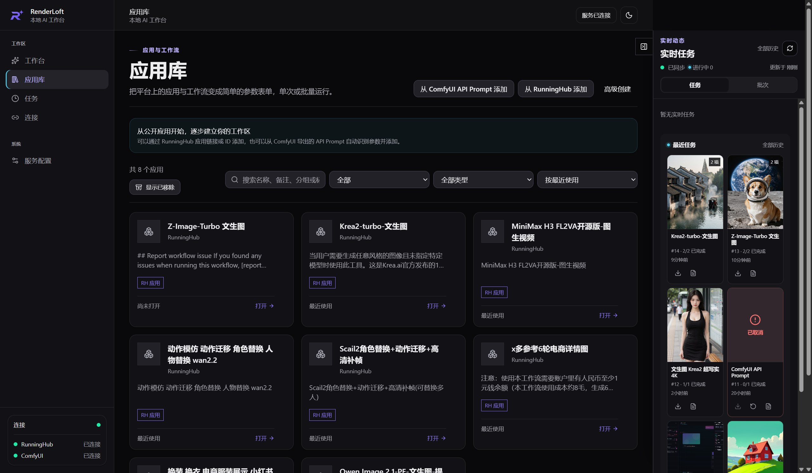
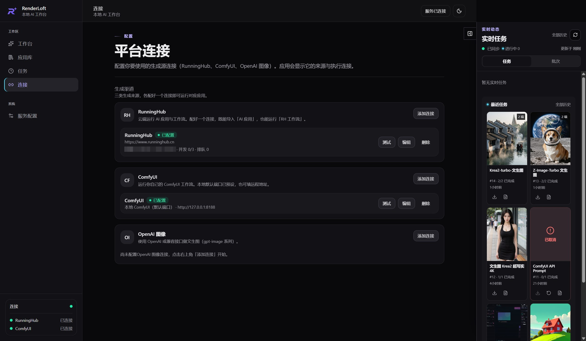
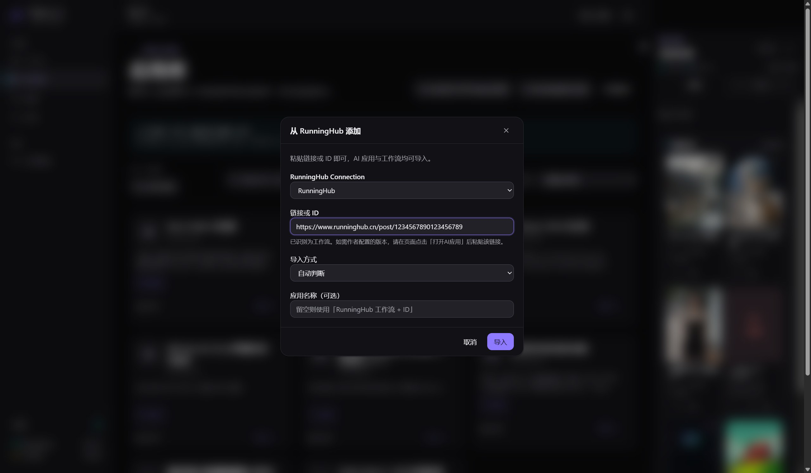
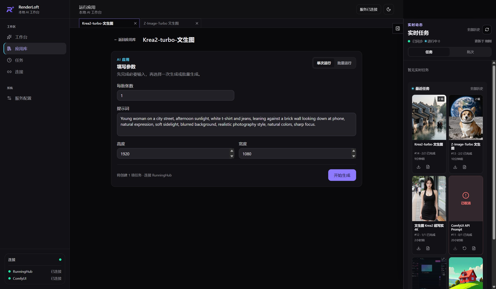
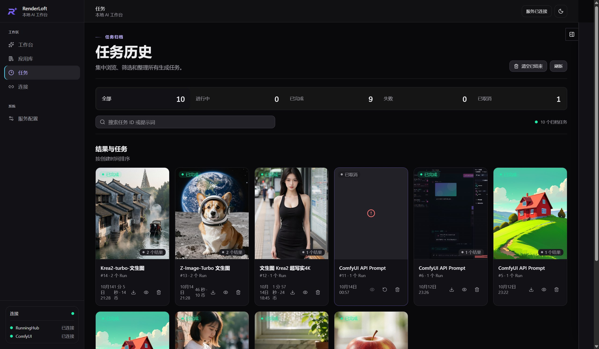
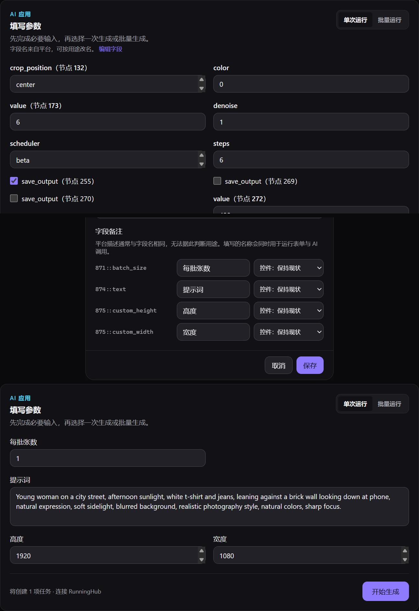

# RenderLoft

> **RenderLoft 是你在本机跑 AIGC 应用的工作台。**
> 连上你的平台账号，把工作流导入成「应用」，填参数就能出图。
> **给字段写一次中文备注名 —— 之后人和 AI 都看得懂。**
> 任何支持 MCP 的 AI 都能直接驱动它；不想用 AI，就用表单和命令行。



它不是画图工具（它不生成图，它让**别的机器**去生成），不是云平台（连接、密钥、历史、产物都在你自己的机器上），也不是「内置了一个 AI」——它是**接口**。

## 现在能连什么

**平台是可插拔的**：daemon 只认「驱动」不认品牌——接一家新的就是加一个驱动，而参数化、批量、
任务恢复、产物管理这些能力不随平台变（接缝写在 [ARCHITECTURE.md](ARCHITECTURE.md)）。

| 能力来源 | 怎么接 | 现在能做什么 |
|---|---|---|
| **RunningHub**（国内站 / 国际站） | 平台 API Key | 粘链接或 ID 导入平台上的**应用**与**工作流**，参数化成表单再跑 |
| **ComfyUI**（本机 / 云端，含跑在 RunningHub 云端的代理地址） | 服务地址；云端那档复用一条 RunningHub 连接的 Key | 导入 ComfyUI「保存(API 格式)」的 JSON，再勾选要暴露成表单的字段 |
| **OpenAI 兼容的图像 / 模型 API** | 平台地址 + Key | 拉取平台声明的模型清单，勾选这条连接要跑的模型 |

> 下面各节里会出现很多 RunningHub 的具体字样（Key 在哪、去哪注册、字段为什么长那样）——
> 那是**拿它当例子**讲清楚一条连接怎么配通，不是这个产品只认它。

## 获取

到 [Releases](../../releases) 下载 Windows 安装包（NSIS），装完直接打开就是完整应用——daemon、控制台、CLI、MCP 都在里面，不需要另装 Node 或 Rust。同一个 release 里还有一个免安装 zip（四个 exe + `dist/`，解压即用）。

> **仓库还没发布过 Release 时**（`../../releases` 是空的），按下面的[开发](#开发)一节自己编译：装好 Node + pnpm + Rust 之后一条 `pnpm build:windows` 就能产出安装包与免安装 zip。

**升级**：下载新版本、覆盖安装即可。**工作区（应用库、任务历史、产物）与 API Key 都在安装目录之外**——分别是 `%LOCALAPPDATA%\renderloft-workspace` 与 Windows 凭据库——所以覆盖安装不会丢数据。安装包目前**没有代码签名**，升级后首次运行仍可能看到 SmartScreen 的「未知发布者」，点「仍要运行」即可。

### Linux（无头版）

Linux 的形态是**无头**：没有桌面壳、也没有托盘——**CLI、网页控制台（daemon 伺服）、MCP 三入口共用同一个 daemon**。发布时会连同 `RenderLoft_<版本>_x64-linux.tar.gz` 一起提供（从下一个版本起）；也可以自行从源码构建（需要 Node + pnpm + Rust）：

```bash
pnpm install
pnpm build:linux   # → RenderLoft_<版本>_x64-linux.tar.gz（三件套 + dist/，解压即用）
pnpm smoke:linux   # （可选）从解压包全链路自检：CLI → daemon → 控制台 → MCP
```

用法与下文「用命令行（可选）」一节相同，只是没有 `.exe` 后缀：解压目录里直接 `./renderloft-cli`；控制台在 `http://127.0.0.1:31337/`；MCP 客户端指向解压目录里的 `renderloft-mcp`；`./renderloft-cli daemon stop` 收工。**便携包不碰系统目录、不写 PATH。**

> 已知点：Linux 的密钥存进系统密钥环（Secret Service，经 D-Bus）——桌面发行版自带；纯服务器 / 容器环境里没有它时，保存平台连接密钥需要先备好 keyring 服务（如 gnome-keyring）。便携包不打包系统库：运行需要系统提供 `libdbus-1` 与 `libssl`（常见发行版都自带，极简容器里需补装 `libdbus-1-3` / `libssl3`）。

## 三步开始

### 1️⃣ 连上你的平台



在「连接」页填平台地址与 API Key。

**以 RunningHub 为例，API Key 在哪**：登录 runninghub.cn（或 .ai）→ 打开「API」页面 → 进「控制台」→ 复制 API Key，粘回连接页。国内站与国际站是两套独立账号，各配一条连接即可。

**还没有账号？** 到 runninghub.cn（或 .ai）注册一个即可。

**密钥由 Rust daemon 写进系统凭据库（Windows Credential Manager），不进 SQLite、不进日志、不进错误响应。** 界面上也**只显示它的尾号**（如「已保存 · 尾号 a1b2」），不显示密钥本身——截图、录屏、剪贴板都拿不到它。

支持 RunningHub（国内 / 国际）、ComfyUI（本机或云端）、OpenAI 兼容的图像 / 模型 API：

- **ComfyUI 跑在 RunningHub 云端**（地址形如 `https://www.runninghub.cn/proxy`）时，用的**就是** RunningHub 那把 Key——所以界面不让你再填一遍，改成从下拉里**选一条 RunningHub 连接**：密钥不存第二份，那边轮换自动生效，删了这边立刻报错。
- **OpenAI 兼容的图像 API** 可以点「拉取可用模型」把平台声明的模型清单拉下来，勾选这条连接能跑的那几个；之后运行表单里的「模型」字段就是这几个选项，不用手打模型名。连接上还能设一个**默认模型**（运行和配方都没点名时用它；都没说就交给平台自己的默认——我们不替你编一个）。

### 2️⃣ 导入一个应用

在「应用库」页导入：



- **从 RunningHub 添加** —— 粘贴链接或 ID 就行，**AI 应用与工作流都能导入**：粘进去它会自己认出是哪种（`…/ai-detail/<id>` 是应用，`…/post/<id>` 是工作流），想指定也可以在「导入方式」里选。
- **从 ComfyUI API Prompt 添加** —— 粘贴 ComfyUI「保存(API 格式)」导出的 JSON；也可以粘 RunningHub 工作流链接或 ID 让平台拉取，再自己勾选要暴露成表单的字段。

### 3️⃣ 填参数、出图



打开应用 → 填表单 → 运行 → 在「任务」页看进度 → 在产物里取图。界面顶部实时显示平台余额。



每个任务下面那行「27 秒 · 6 币」是**平台自己报的**用量（耗时与币在平台的同一个响应里）——同一张图两次跑价钱可能不同，我们不替你估算。

## 关掉窗口之后

**点 X 不是退出，是收进托盘**——因为一次云端出图是分钟级，你多半会去干别的：

- 窗口关了，**任务照旧跑完**：daemon 留在后台对账、轮询，跑完时弹一条系统通知；
- 托盘图标（右下角，可能被 Windows 收进溢出区）右键 → **打开控制台** / **退出**；
  左键点它也是打开控制台；
- 托盘悬停会写"正在跑几个任务"；
- **真正退出**只有托盘菜单里的「退出」（或 `renderloft-cli daemon stop`）——那时 daemon 才停。
  就算在任务跑到一半时退出了也不丢：**平台侧会继续跑**，下次打开自动对账回来。
- 只想要一个窗口、不想让它常驻？任务跑完自己点托盘里的「退出」即可；本程序**不做开机自启**。

## 关键的一步：给字段写备注名

平台给的字段名是机器话：`874::text`、`871::batch_size`。



三格是同一件事的三步：

- **上**：还没整理过的一条应用（31 个字段）。`value`、`save_output` 各重名好几次，重名的只能靠括号里的节点号分开——那是**图里节点的编号**，是事实，不是我们起的名；
- **中**：在「编辑字段」里**写一次名字、挑一次控件**（单行文本 / 多行文本 / 数字 / 开关 / 下拉 / 文件）；
- **下**：整理过的应用，运行表单直接用上了这些名字。

之后：

- **人**看到的表单是「提示词」「每批张数」
- **AI** 通过 MCP 拿到的 schema 描述也是「提示词」「每批张数」

> **一次策展，两个观众。** 这是这个产品相对平台扁平目录的核心价值。

备注名**只能在界面上写**——改元数据属于「策展」，是人的判断，我们刻意不把它交给 AI。

## 用 AI 驱动它（可选）

RenderLoft 自带一个 MCP 服务器（stdio），把本机 daemon 的能力暴露给任何 MCP 客户端。**它对外只有两个工具**：

```
renderloft_catalog          看能做什么（索引；给一个 verb id 就返回那个动词的完整 schema 与语义）
renderloft_call             调用：{"verb": "operation.run", "args": {...}}
```

为什么只有两个：模型每一轮都要重新从文本里推出"我能做什么"，所以**索引必须常驻**（否则能力等于不存在）；但"怎么调"（完整描述 + schema）**用到才要**。扁平列表把两件事混在一起——它把"怎么调"对每一个能力、每一轮都付一遍。

**这两个数字是量出来的，不是估的**（`node scripts/mcp-cost.mjs`，驱动真的 `renderloft-mcp.exe`，只读、不花钱）：现在**常驻 ≈1,100 tokens**（`instructions` 246 + 两个工具 855，占 128k 上下文的 0.86%）；若把这 14 个动词平铺成原生工具，**常驻 ≈3,270 tokens**（2.55%）——**省下约 2,200 tokens**。索引本身 ≈3,280 tokens，按需取、不进常驻。想复量就自己跑那个脚本（改了描述或标记之后**必须**重跑——手抄的数字会漂，实测过）。

> 这套形状的完整推导（公理 → 设计律 → 物理边界 → 可证伪的判据），以及"元层该不该继续当自动化入口"这个**尚未决定**的岔路，写在 [`docs/mcp-surface.md`](docs/mcp-surface.md)。

**那 agent 怎么知道这个 MCP 是干嘛的？** 常驻文本的**第一句**就是身份与触发条件：

> RenderLoft — a local workbench that runs the user's own image/video generation apps on their own cloud platform accounts (RunningHub / ComfyUI), tracks the tasks in the background, and collects the resulting files. **Use it when** the user asks to generate, edit, restyle, upscale or batch images/videos — or to see which apps (recipes) they have, what a task cost, or where its outputs went. Runs spend the user's own credits: **[COST]** marks the verbs that charge their account, **[IRREVERSIBLE]** the ones that cannot be undone.

同一句也放在 MCP 的 `initialize.instructions` 里（协议里专门放"这个 server 是干嘛的"字段）。**为什么必须说**：元层把自带领域暗示的工具名（`renderloft_run_recipe`）换成了中立的调用口，于是"这是什么"就没有别的地方可放了——**不可见就等于不存在**。

对你的实际意义：**没在干这活的时候，它对 agent 的判断与上下文的干扰很小** ✓ —— 而"这个动词花钱 / 会破坏东西"这类风险档，就写在常驻索引的那一行上，**首行固定 ASCII 前缀**（`[COST] operation.run — 提交任务`）——不是写进句子里，也不是靠一个容易看漏的符号（这类标记有测试钉着"标记集合 == 动词表"，漏一行就红）。

**服务端已经在强制的上限，都写在协议地板上**（不是只写在说明文字里）：单次调用最多 100 个 Run（**每条单独计费**，落成参数 schema 的 `maxItems`）、自主调用方（MCP）并发 ≤4、列表回执截断 20 条 / 64KB——三档数字直接取自执行它们的常量，`instructions` 里同步报一遍。

**回执也是有界的**（输入侧管"每轮付多少"，输出侧管"一次调用能灌进多少"）：列表超过 20 条会截断，并**明说**"共多少、只给了多少、怎么拿更多"——**绝不悄悄丢**（悄悄截断比不截断更坏：模型会以为看到的就是全部）。要翻页就传 `limit` / `after`（`artifact.list`、`operation.list` 都支持）。

**刻意不给 AI 的动词不在索引里，也调不到**（元层会拒绝）：写密钥、关 daemon、往磁盘写文件、建连接——它们属于人的动作。这条有测试钉着（负对照：把拒绝删掉 ⇒ 红）。

在你的 MCP 客户端配置里指向 `renderloft-mcp.exe` 即可。**它和界面是同一个安装包里的同一个目录**（安装版默认在 `%LOCALAPPDATA%\RenderLoft`），不需要单独下载：

```json
{
  "mcpServers": {
    "renderloft": { "command": "C:\\Users\\<你>\\AppData\\Local\\RenderLoft\\renderloft-mcp.exe" }
  }
}
```

> 自己编译的话路径是 `<仓库路径>\src-tauri\target\release\renderloft-mcp.exe`；用免安装 zip 的话就是解压目录里的那个；**Linux 便携包里是解压目录里的 `renderloft-mcp`**（无 `.exe` 后缀）。
> `renderloft-mcp.exe` 是 **stdio 服务**：由 MCP 客户端按需拉起，不用常驻。它连的 daemon 如果没在跑，**它会自己把旁边的 `renderloft.exe` 拉起来**（CLI 也一样）——所以不必先打开界面。

然后就能直接说：

> 用 Krea2-turbo 画一只在草地上的猫，等它完成，把图给我。

它背后走的是 `catalog → call(recipe.list) → call(recipe.describe) → call(operation.run)`——**不需要你解释字段是什么意思**，因为备注名已经写在 schema 里了。

**长任务别在工具调用里等。** MCP 的工具调用是请求/响应：`operation.wait` 等太久会把客户端那条通道占住（实测过一次，后面的调用全部排队超时）。要"提交完就走、跑完通知我"，就在提交时给一个回调地址：

```powershell
renderloft-cli operation run --recipe-revision 1 --input cat.json --callback-url http://127.0.0.1:8787/hook
```

任务进终态时，daemon 会 POST 一份快照过去（失败按退避重试，投递记录留在库里）：

```json
{ "operationId": 73, "status": "SUCCEEDED",
  "runs": [ { "runId": 77, "status": "SUCCEEDED", "clientRunId": "run-b6f50adf…" } ] }
```

地址必须是 **https**，或**回环地址的 http**（`127.0.0.1` / `localhost` / `[::1]`）——本地接收端不用造证书；内网与公网地址只收 https。

### 验签（接收端怎么确认"这确实来自我的 RenderLoft"）

自己生成一串随机密钥，两边填同一个值——**它只进不出**：RenderLoft 只写不读（读回来只有"配没配"）。

```powershell
# 你自己生成（例：32 字节随机），填进接收端，再交给 RenderLoft
renderloft-cli callback set-secret --from-file .\callback-key.txt   # 值只从文件读，不进命令行
renderloft-cli callback status                                      # {"configured": true}
renderloft-cli callback clear-secret                                # 关掉签名（想换密钥时先清再设）
```

配上之后，每次投递都带这个头：

```text
X-RenderLoft-Signature: t=1791609031058,v1=<hex>
```

接收端按这个契约验（**顺序别弄反**）：

1. 取 `t`（毫秒时间戳）与 `v1`（十六进制签名）；
2. 用同一个密钥，对 **`"{t}.{请求体的原始字节}"`** 算 HMAC-SHA256；
3. 与 `v1` 比较（常数时间比较），并拒绝太旧的 `t`（防重放，窗口多大你自己定）。

> 为什么签的是"原始字节"：签名那头用的是同一份序列化结果，所以两边逐字节一致。
> 这也意味着**别在中间重新序列化 body**（换键序、加空格都会验不过）。

没配密钥就**不带**这个头——宁可不签，也不签一个假的。所以"要不要验签"由你的接收端决定：**看到头就必须验，验不过就拒收**。

### 产物怎么拿到手

`artifact list` 里 `byteSize` 为 0 的产物，**字节还在平台上**（中转站定位，不落本地）——用这一条按需拉下来：

```powershell
renderloft-cli artifact download --artifact 999002000 --to D:\pics\        # 给目录（不存在会建）
renderloft-cli artifact download --artifact 999002000 --to D:\pics\cat.png # 或指定文件
```

**文件名一律照抄平台给的**（浏览器、`curl -O`、`wget` 都不改名）。但**往一个目录里收一批**时会撞名：
RunningHub 按输出节点命名，同一个应用的每个 run 都产出 `870.png`。所以目录落点带冲突策略——
默认 `rename`，加序号（`870.png` → `870 (1).png`，与浏览器 / yt-dlp 同形），并在输出里说明改存到哪：

```powershell
renderloft-cli artifact download --artifact 999002001 --to D:\pics\                    # 默认 rename
renderloft-cli artifact download --artifact 999002001 --to D:\pics\ --on-conflict skip # 收过就不动
renderloft-cli artifact download --artifact 999002001 --to D:\pics\ --on-conflict overwrite
```

> `--to <文件>` 是**显式落点**：你说了算，照写（与 `curl -o` 一致）；`--to <目录>` 是"你帮我决定名字"，
> 所以由动词兜底。**静默覆盖是最坏的一种**——它不报错，事后只能靠翻目录发现少了几张。

**想自己定名字就 `--name-template`**（对应 yt-dlp 的 `-o`）——占位符只有两个，都来自产物元数据：

```powershell
renderloft-cli artifact download --artifact 999002001 --to D:\pics\ --name-template "{artifactId}/{filename}"
#   → D:\pics\999002001\870.png        （一个产物一个子目录：不污染文件名，也不会撞）
renderloft-cli artifact download --artifact 999002001 --to D:\pics\ --name-template "{artifactId}-{filename}"
#   → D:\pics\999002001-870.png        （前缀就是 id，随时能回查）
```

> 为什么只给 `{artifactId}` / `{filename}`：模板是"把已有的事实换个排法"，不是"生成新信息"。
> `{date}` 这类会让同一条命令在不同时刻产生不同结果。模板必须是 `--to` 目录内的**相对路径**
> （可含子目录）——绝对路径与 `..` 一律当场拒绝，否则"往哪写"就不再由你决定了。

**同一个 run 内的产物名保证互不相同**（`870.png` → `870-2.png`）：RunningHub 按输出节点命名，
一个节点吐多张图时会撞，而那是两条不同的记录——不区分开就没法认哪张是哪张。跨 run 重名是正常的
（同一个应用每次跑都产出 `870.png`），那由上面的落点策略管。

不想写接收端、也不想挂着 daemon 等通知？那就**定时来收**——仓库里带了一个示例脚本，它只调 CLI：

```powershell
node scripts\collect-artifacts.mjs --to D:\pics     # 收"已结束任务"里还没收过的产物
```

它把收过的记在 `D:\pics\.collected.json`，重复跑不会重复下载；每轮结果追加在 `D:\pics\.collect.log`
（**后台任务不能是哑的**——挂上任务计划后 stdout 没人看，日志是排查"为什么没收到图"的唯一线索）；挂到任务计划就是全自动：

```powershell
schtasks /create /tn RenderLoft收图 /sc minute /mo 10 ^
  /tr "node D:\path\to\collect-artifacts.mjs --to D:\pics --only-if-running"
```

> `--only-if-running`：daemon 没在跑就跳过。不加的话，普通动词会顺手把 daemon 启动
> （"启动但不拥有"），于是一个每 10 分钟跑一次的后台任务会把你**手动停掉**的 daemon 反复拉活
> ——那不是它该管的事。`daemon status` 恰好是唯一不自动拉起的动词，脚本问的就是它。

> 一个实测出来的坑，脚本已经替你处理了：`operation list` 给的是**摘要**（没有 `runs`），
> 要按 runId 找产物得逐个 `operation get`。
>
> 还有一件**真的是平台的怪癖**：文件名可能是 `.png` 而**实际字节是 JPEG**（我们就遇到了）——
> 看图软件一般不在乎，但严格按扩展名解析的工具会在意。它和上面那条撞名不同：**字节类型是平台说了算，
> 名字的冲突是"我们把它收进一个目录"造成的**，所以后者由我们兜底。

**刻意不给 AI 的三件事**：写密钥、写备注名、建/删连接。它们改的是「谁能跑什么」这条授权边界本身，而 AI 正受这条边界约束。同理只给 CLI 的还有两处：`callback set-secret`（MCP 的参数是模型生成的，密钥进去就等于进了模型上下文与对话记录）与 `artifact download`（它往磁盘任意路径写文件）。

## 用命令行（可选）

和界面、MCP 同一个安装包里的同一个目录。**安装时会把安装目录加进你的用户 PATH**（卸载时自动移除），所以装完开一个**新**终端就能直接敲 `renderloft-cli`：

```powershell
renderloft-cli recipe list                               # 有哪些应用
renderloft-cli recipe describe --recipe 1                # 它的字段（含备注名）
renderloft-cli operation run --recipe-revision 1 --input cat.json
renderloft-cli operation wait --operation 70
renderloft-cli artifact list
```

> 免安装 zip 不会改 PATH（那本来就不是"安装"），用解压目录里的全路径即可：
> `& "D:\你解压的位置\renderloft-cli.exe" recipe list`。

> `--input` 是 JSON 文件，内容要匹配该应用的 schema；**文件不要带 BOM**（用 `Set-Content -Encoding utf8NoBOM` 或直接写）。
> CLI 一次提交一个任务；**一次提交多个用 MCP 的 `run_recipe`**。
> **退出码与输出流**：成功时信封走 **stdout**、退出码 **0**；失败时信封走 **stderr**、退出码 **1**。所以在任务计划里 `if ($LASTEXITCODE -ne 0) { 报警 }` 是有效的，`> result.json` 也不会把错误混进去。

全部动词（`renderloft-cli <组> <动词> --help` 看参数）：

| 组 | 动词 |
|---|---|
| `connection` | `list` · `models`（拉平台声明的模型清单）· `set-key`（值只从文件读，默认拒绝覆盖，要覆盖加 `--force`） |
| `daemon` | `status` · `stop`（守护进程本身；**只给 CLI，不给 AI**） |
| `callback` | `set-secret` · `status` · `clear-secret`（回调签名密钥；**只给 CLI，不给 AI**） |
| `recipe` | `list` · `describe` · `import` · `remove` · `restore`（后两个只给 CLI，不给 AI） |
| `operation` | `list` · `run`（`--callback-url` 见上）· `get` · `wait` · `cancel` |
| `asset` | `upload` |
| `artifact` | `list` · `get` · `download`（下载字节；只给 CLI，不给 AI） |
> daemon 没在跑也没关系：CLI 会自己把旁边的 `renderloft.exe` 拉起来（**只启动，不拥有**——它不会替你关掉 daemon，也不会改你的环境变量）。冷启动约 **0.6 秒**，之后每次调用约 **70 毫秒**。
>
> 想知道它在不在、想关掉它：
> ```powershell
> renderloft-cli daemon status   # 在不在跑、版本、日志在哪、还有几条任务没结束
> renderloft-cli daemon stop     # 优雅退出（任务不会丢：平台侧继续跑，下次启动对账回来）
> ```
> 这两条**只给 CLI**（MCP 那侧没有）：进程生命周期是人的事——任务在后台跑、对账靠 daemon 常驻，不该让 AI 有权把它关掉。

典型的"跑一次并拿到结果"：

```powershell
renderloft-cli recipe list                            # 拿 recipeId 与 defaultConnectionId
renderloft-cli recipe describe --recipe 1             # 拿 currentRevisionId 与字段 schema
renderloft-cli operation run --recipe-revision 1 --input cat.json --idempotency-key daily-2026-10-09
renderloft-cli operation wait --operation 70 --interval 5 --timeout 600
renderloft-cli artifact list                          # 产物（byteSize 0 = 字节还在平台上，不是空文件）
```

因为是普通的命令行程序，它也能被任何调度器调用——例如「每天 9 点生成一张」用 Windows 任务计划即可。

## 它是怎么工作的

```text
GUI（Vue + Tauri）/ CLI / MCP —— 都是客户端
                    │  HTTP + SSE（/api/v1，本地回环）
            Rust daemon —— 唯一业务宿主
                    │  调度 · 对账 · 重试 · 幂等 · 密钥
        SQLite + 产物目录 + 系统凭据库
                    │
      RunningHub / ComfyUI / 模型 API
```

**推理交给你的 AI（它会持续变强），能力、状态、信任留在本地（越用越厚）。**

## 卡住了看这里

**「连接测试失败」**：**先读那一行红字**——它就是为了省掉猜。缺 Key、平台回了 401（Key 不对或过期）、余额不足、连不上（地址写错、或代理没在跑），各自的原因都写在连接行里。改完点那一行的「测试」再验一次。

**明明能上网，应用却说连不上平台**：看环境里有没有 `HTTP_PROXY` / `HTTPS_PROXY` 指向一个**没在跑**的代理（常见于关掉代理软件之后）。这时"连不上平台 / Key 好像坏了"是假象——回环地址不走代理，所以本机 ComfyUI 反而是绿的。把变量清掉再启动应用即可。

**提交时被平台拒（如队列已满）**：平台的上限由平台说了算，被拒会被当成「等一会儿」**自动重试**，不是失败。别反复点「开始生成」——那只会把并发占得更满。

**截图/日志里能不能出现密钥**：不能。密钥只在系统凭据库里，界面只显示尾号，daemon 从不回传它。

## 如实说明

- **历史只到最近 100 条**（任务页一次拉 100、渲染 20，没有分页）。
- **产物的 `byteSize` 可能是 0**：含义是「字节还在平台上」——RunningHub 只给 URL 不给字节。真下载过的产物才有真实大小与 checksum。界面不展示这个字段。
- **用量来自平台自己的报价**（RunningHub 的 `consumeCoins`）；平台没说就是没说，**不会替你估算**。单价是浮动的。
- **不做并发控制**：平台的上限由平台说了算。被拒（如队列已满）会被当成「等一会儿」自动重试，而不是失败。
- 任务历史、产物、凭据都在**本机**；只有「生成」这一步会发到平台。

## 开发

需要 Node.js、pnpm、Rust，以及 Windows Tauri 所需的 C++ 构建工具。

```powershell
pnpm install
pnpm dev            # daemon(127.0.0.1:31337) + 控制台(http://127.0.0.1:5174)
pnpm build          # 前端类型检查 + 构建
pnpm verify         # 完整门禁：lint · 格式 · 分层 · 配色契约 · 版本号 · 前端构建 · clippy · Rust 测试
pnpm build:windows  # 打 Windows 安装包（NSIS）
pnpm build:linux    # 打 Linux 无头便携包（tar.gz：三件套 + dist/）
```

分层约束由 `scripts/check-layers.mjs` 守门：daemon 是唯一业务宿主，只有调度器能向平台提交，写端点必须是应用用例。

### 发布

版本号只有一个真相来源：根 `package.json`。其余 5 处（两个 `Cargo.toml`、`desktop/tauri.conf.json`、两个 `Cargo.lock`）由脚本同步，`pnpm verify` 与 CI 都会校验一致性——**不一致时编译、测试、打包全绿，只有将来的 updater 会静默判断错版本**。

```powershell
pnpm version:bump minor        # 0.1.0 → 0.2.0，6 处一起改
git commit -am "chore(release): v0.2.0"
git tag v0.2.0
git push --tags                # tag 触发 .github/workflows/release.yml
```

`release.yml` 先校验 **tag 与版本号一致**，再打包、生成免安装 zip 与 `SHA256SUMS.txt`，发成 GitHub Release（notes 由 commit 自动生成）。

> CI 与 Release 都由 **GitHub Actions** 跑（`.github/workflows/`）。
>
> Gitee 那边是**代码镜像**：代码同步过去，但**不发 Release 附件**——安装包以 GitHub Releases 为准。
>
> CI 里那个 `windows-installer` job 产出的是 **Actions artifact**（14 天过期、下载要登录 GitHub）——它只用于调试，**不是给用户的下载渠道**。

## 文档

- [产品愿景](docs/product-vision.md)
- [架构与技术选择](ARCHITECTURE.md)
- [当前状态](docs/status.md)
- [维护指南](docs/AGENTS.md)

## 许可证

[MIT](LICENSE) © 2026 inorizx
